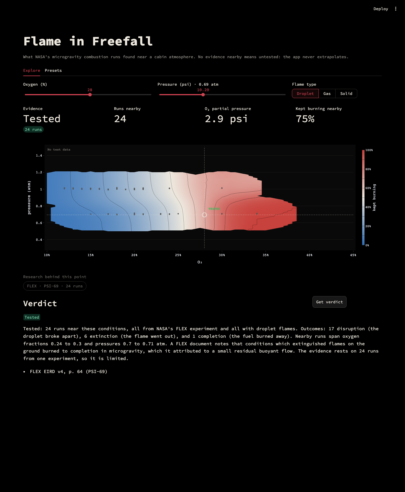
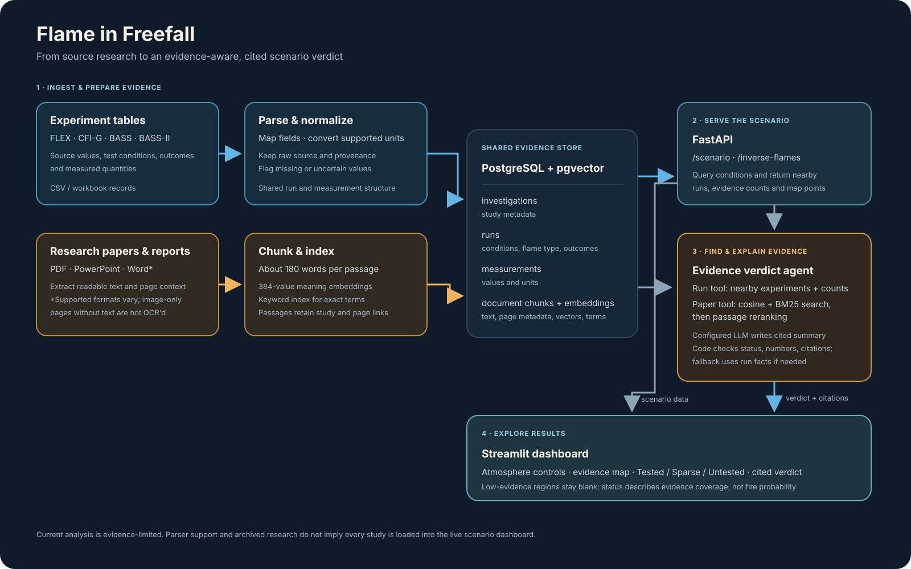
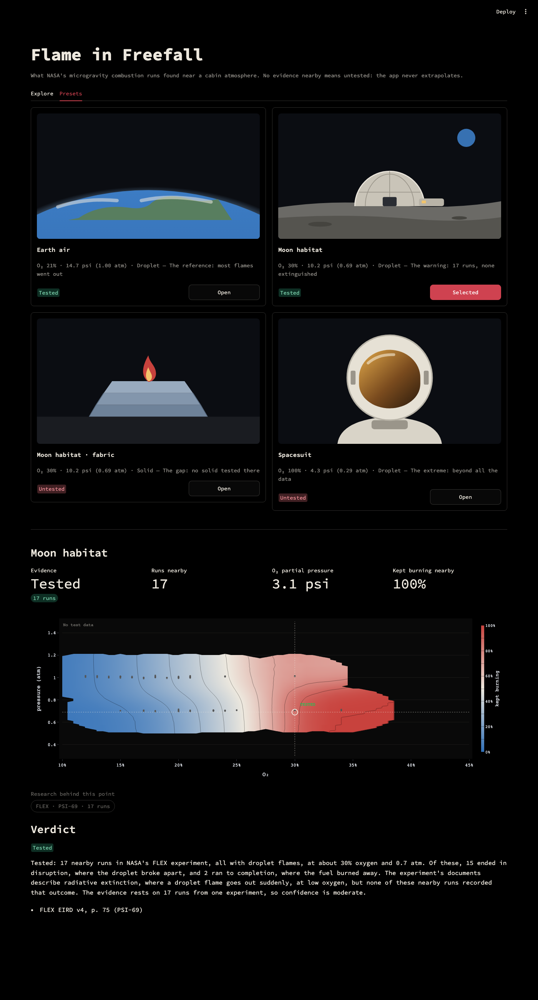

# Flame in Freefall

### A research dashboard for understanding fire in microgravity

Flame in Freefall brings numerical results and research documents from NASA’s Physical Sciences Informatics (PSI) combustion studies into one evidence-aware exploration tool. Choose an atmosphere and flame type to see nearby experiments, inspect where evidence exists, and retrieve a short explanation grounded in study data and cited passages.

> **The project is a research and exploration prototype.** “Tested,” “Sparse,” and “Untested” describe the amount of nearby experimental evidence. They are not calibrated fire probabilities, safety certifications, or operational guidance.



## Summary

- **Explore conditions:** compare oxygen fraction and pressure with nearby experimental runs for droplet, gas, or solid flames.
- **See evidence coverage:** the scenario map visualizes observed outcomes where the data supports it and leaves low-evidence regions blank instead of extrapolating.
- **Read cited research:** a retrieval-augmented generation (RAG) agent combines nearby run summaries with passages from indexed PSI documents.
- **Know the limits:** verdict status is set by a transparent run-count rule; citations and numeric claims are checked before an answer is returned.
- **Build toward broader coverage:** the repository includes ingestion and normalization work for FLEX, CFI-G, BASS, and BASS-II. Additional investigations and smoke-detector time series remain future integration work.

## Why this matters

Fire does not behave identically in every environment. Oxygen fraction, total pressure, fuel, geometry, ventilation, and gravity all affect combustion. In microgravity, buoyancy-driven convection is greatly reduced; heat and combustion products do not rise in the familiar Earth-bound way, and transport depends more on diffusion and forced ventilation. Those combined conditions mean Earth-based intuition alone is not enough to characterize spacecraft fire behavior.

Spacecraft do not share one atmosphere. The International Space Station cabin is approximately Earth-like in oxygen fraction and pressure, while some spacesuits operate at low pressure with nearly pure oxygen to provide a breathable oxygen partial pressure and maintain suit mobility. That design trade-off makes oxygen-rich environments an important fire-safety consideration.

The history of human spaceflight reinforces the need for careful evidence. The Apollo 1 cabin fire during a ground test in a high-pressure pure-oxygen atmosphere killed three astronauts. Apollo 13 was a different emergency: an oxygen-tank failure caused an explosion and loss of spacecraft systems. These events are not interchangeable, but both underline the importance of understanding spacecraft hazards and designing for them.

## What the project does

The project connects two types of evidence: structured experiment records and the documents that explain the research.

<!-- Architecture diagram slot: paste this Markdown here when ready:

-->

### 1. Experiment data: make records comparable

Research tables use different column names, formats, and units. The ingestion parsers map source records into a shared representation, convert supported units, retain raw source values, and record provenance or quality flags where applicable. This creates a consistent basis for comparing experiments without discarding the original context.

The core data concepts are:

| Record | What it represents |
| --- | --- |
| **Investigation** | A PSI study: its acronym, title, objective, hardware, dates, and source metadata. |
| **Run** | One test or experiment record, with flame configuration, fuel or material, oxygen fraction, pressure, outcome, and source context when available. |
| **Measurement** | A numeric result associated with a run, such as burn time or another study-specific variable, with its unit. |
| **Document chunk** | A passage from a paper or report, associated with a study and page or slide when available, plus its search embedding. |

<!-- The system architecture image also shows how these schema records connect. -->

**Current scope:** parser and normalization code covers FLEX, CFI-G, BASS-II, and BASS sources. The interactive scenario and verdict experience is evidence-limited; its documented demo examples center on FLEX and CFI-G. BASS/BASS-II solid outcomes are not yet complete enough to support a reliable solid-material risk surface. Ingestion support does not mean every source has already been loaded into the live dashboard.

### 2. Research search: find the relevant passages

A full report is too large to compare directly with a question. The document pipeline splits supported PDF and PowerPoint text into overlapping passages of about 180 words, keeping each passage within a page or slide where possible. Each passage is represented by a 384-number embedding: a compact “meaning fingerprint” that helps retrieve related text even when the wording differs.

At question time, the search pipeline:

1. Finds passages that are close in meaning using cosine distance between embeddings.
2. Finds passages containing useful exact terms using BM25 keyword ranking.
3. Combines the two rankings, then reranks the shortlist with a model that reads the question and passage together.
4. Returns the strongest passages with study, document, and page information for citations.

The embedding model is `BAAI/bge-small-en-v1.5`; the passage reranker is `cross-encoder/ms-marco-MiniLM-L-6-v2`. These models support document retrieval; they do not directly calculate fire risk.

### 3. Evidence verdict: explain what is known

For a scenario, the API compares its oxygen fraction and pressure with recorded runs using a normalized distance. Runs inside the configured neighborhood count toward the evidence summary. The agent then uses tools to retrieve the run summary and relevant paper passages, and writes a concise plain-language response with citations.

The model is selected through `LLM_MODEL`; if it is unset, the code uses `anthropic:claude-haiku-5-5`. The agent is implemented with PydanticAI. Application code determines the evidence status and validates the response’s status, numbers, and citations. If the language model fails, the API can return a code-written factual fallback based on the loaded run data.

| Status | Meaning in this prototype |
| --- | --- |
| **Tested** | At least 3 nearby runs are present. |
| **Sparse** | 1 or 2 nearby runs are present. |
| **Untested** | No nearby runs are present; the closest runs may be shown as context. |

These labels describe data coverage, not confidence intervals or a probability that a fire will occur. A relevant paper passage can provide context, but it does not turn an untested condition into a directly tested one.

## Dashboard scenarios

The Presets tab provides three example conditions:

| Preset | Oxygen | Pressure | Flame | Intended role |
| --- | ---: | ---: | --- | --- |
| Earth-air conditions in space | 21% | 14.7 psi (about 1 atm) | Droplet | Reference condition |
| Moon habitat | 30% | 10.2 psi (about 0.69 atm) | Droplet | Explore a higher-oxygen, lower-pressure habitat example |
| Spacesuit | 100% | 4.3 psi (about 0.29 atm) | Droplet | Highlight conditions beyond current evidence coverage |

In the documented FLEX example near Moon-like conditions (oxygen at or above about 29% and pressure near 0.70 atm), 17 droplet runs were identified: 15 recorded **disruption**, 2 **completion**, and 0 **extinction**. The source documentation does not establish that “disruption” means the flame continued burning, so the project preserves that outcome label rather than claiming flame persistence. These results come from one study and a limited number of tests; they are not a universal prediction for lunar habitats.

The dashboard’s risk surface is designed to show observed evidence only where enough nearby runs exist. Areas below the evidence threshold remain blank. Solid scenarios can show run locations, but solid outcomes are not currently adequate for a dependable risk surface.



## Research coverage and roadmap

The PSI archive includes many related investigations. The repository’s audit identifies source datasets and documents that may be useful, but their presence in the research inventory does not mean all are integrated into current scenario analysis.

| Investigation family | Research relevance | Project status |
| --- | --- | --- |
| **FLEX** | Droplet-flame extinction and outcomes across combustion conditions. | Core documented scenario evidence. |
| **CFI / CFI-G** | Cool flames in droplet and gas configurations; CFI-G includes ignition outcomes. | CFI-G has parser support and is part of the documented analysis scope. |
| **BASS / BASS-II** | Solid-material burning and suppression. | Parser/normalization work exists; outcome coverage limits solid risk analysis. |
| **SAFFIRE I–III** | Larger-scale fire and flame-spread experiments in spacecraft settings. | Future data integration and analysis. |
| **SAME / SAME-R** | Smoke and aerosol measurement, including detector channels and time series. | Future ingestion and detector-focused work. |
| **DAFT / DAFT-2** | Dust and aerosol measurement feasibility. | Future integration and analysis. |

Potential next steps include expanding study adapters, bringing more tables and report text into the shared index, adding quality and coverage summaries, and integrating SAME/SAME-R time series to investigate how smoke signals evolve in microgravity. Smoke transport and detector response may differ from Earth expectations, but the current project does not detect fires or predict detector performance.

## Potential applications

As a research and planning aid, the project could help teams:

- Compare existing experimental evidence for candidate habitat and suit atmospheres.
- Identify conditions with strong, sparse, or missing experiment coverage and prioritize future tests.
- Find source papers and connect numerical results to their technical context.
- Explore research questions about materials, ventilation, suppression, and smoke detection.
- Communicate microgravity combustion findings to mission planners, researchers, and learners.

These are potential applications. The prototype does not replace engineering analysis, NASA or other agency certification, fire-safety requirements, or crew emergency procedures.

## API overview

The FastAPI service exposes these documented routes:

| Route | Purpose |
| --- | --- |
| `GET /scenario` | Return nearby and closest runs for an oxygen, pressure, and optional flame-type query. |
| `GET /inverse-flames` | Query inverse-flame records using burner-stream oxygen and other filters. Burner oxygen is not cabin oxygen. |
| `POST /verdict` | Return a `tested`, `sparse`, or `untested` evidence summary with citations when available. |
| `GET /docs` | Open the interactive OpenAPI documentation while the API is running. |

Example request:

```bash
curl -X POST http://127.0.0.1:8000/verdict \
  -H 'content-type: application/json' \
  -d '{"o2_frac":0.30,"pressure_atm":0.69,"flame_config":"droplet"}'
```

## Technology

- **Python 3.14** for ingestion, API, search, and dashboard code.
- **PostgreSQL + pgvector** for investigation records, runs, measurements, document chunks, and vector search.
- **FastAPI + Pydantic** for the typed API contracts.
- **Streamlit + Plotly** for the interactive dashboard and evidence map.
- **Sentence Transformers** for passage embeddings and cross-encoder reranking.
- **PydanticAI** for the tool-using evidence verdict agent.
- **Docker Compose** for the local PostgreSQL service.

## Repository map

```text
src/
  api/                 FastAPI routes and scenario queries
  agent/               Paper search, embeddings, and evidence verdict agent
  ingestion/           PSI download helpers and source-table parsers
  contracts.py         Shared request and response models
  models.py            Database schema
frontend/              Streamlit app, charts, presets, and scenario artwork
scripts/               Database, import, parsing, chunking, and fixture commands
data/
  presets/             Preset scenario verdicts
  fixtures/            Small API examples and test fixtures
  processed/           Prepared paper chunks and embeddings
docs/                  Data mappings, API contracts, and implementation notes
tests/                 Unit and integration tests
```

PSI source files are local inputs and are not bundled in this repository. Follow the setup notes below and the source-data instructions in `docs/team_plan.md` before running ingestion commands. The committed chunk parquet supports local paper search without rebuilding embeddings.

## Acknowledgements and sources

This project works with research metadata and documents from NASA’s Physical Sciences Informatics program. The NASA name is used to identify source material; NASA does not endorse this project. Historical and atmosphere context should be checked against primary references, including NASA’s [Apollo 1 history](https://www.nasa.gov/history/55-years-ago-the-apollo-1-fire-and-its-aftermath/), [Apollo 13 summary](https://nssdc.gsfc.nasa.gov/planetary/lunar/ap13acc.html), and [NASA-STD-3001 Volume 2](https://www.nasa.gov/wp-content/uploads/2025/05/nasa-std-3001-vol-2.pdf). See the [Space Apps Challenge brief](https://www.spaceappschallenge.org/2026/challenges/flame-in-freefall/?tab=details) for the challenge prompt.

---

## Setup

### Requirements

- macOS or Linux (Windows users can use WSL)
- Python 3.14
- Docker Desktop or Docker Engine with Docker Compose
- NASA PSI source data placed in the local `psi_data/` directory for source imports
- An API key for the configured LLM provider to generate live verdicts; browsing preset scenarios and run maps does not require an LLM call

### 1. Configure local environment

Create a root-level `.env` file. Keep it local and never commit it:

```dotenv
POSTGRES_USER=flame_user
POSTGRES_PASSWORD=choose_a_local_password
POSTGRES_DB=psi_flame
POSTGRES_PORT=5432

# Optional: defaults to anthropic:claude-haiku-5-5
LLM_MODEL=anthropic:claude-haiku-5-5
ANTHROPIC_API_KEY=your_anthropic_api_key
```

The database settings must agree between Docker Compose and the Python application. Do not put API keys in source code or publish them in screenshots, logs, or commits.

### 2. Install dependencies and initialize the database

From the repository root:

```bash
make setup
```

This creates a Python virtual environment in `.venv314`, installs the project dependencies, starts PostgreSQL with pgvector, applies the schema, imports PSI investigation metadata from `psi_data/`, and loads the committed paper chunks and keyword tables.

The source data is not included here. Ensure the expected PSI investigation folders and metadata files are available locally before running `make setup`. If you are only exploring code or running fixture-backed API development, use the fixture workflows documented below instead of assuming the full PSI source corpus is present.

### 3. Run the API and dashboard

In separate terminals, start the API and the Streamlit UI:

```bash
make api
```

```bash
make frontend
```

Open the Streamlit URL printed in the terminal (usually `http://localhost:8501`). The API’s OpenAPI page is at `http://127.0.0.1:8000/docs`.

### Useful commands

| Command | Action |
| --- | --- |
| `make db-up` | Start the PostgreSQL service. |
| `make schema` | Apply or update the database schema. |
| `make import` | Import investigation metadata from local PSI data. |
| `make load-chunks` | Load the committed chunks and rebuild keyword-search tables. |
| `make api` | Run the FastAPI development server. |
| `make frontend` | Run the Streamlit dashboard; start the API first. |
| `make fixtures` | Regenerate fixture data from supported local experiment sources. |
| `make preset-verdicts` | Generate preset verdicts through the live API and configured LLM. |
| `make test` | Run the unit test suite. |
| `make test-live` | Run tests against the configured live LLM; requires provider credentials. |
| `make verify` | Inspect database tables and imported investigation records. |
| `make db-down` | Stop PostgreSQL while preserving its data volume. |

See [`docs/paper_search.md`](docs/paper_search.md), [`docs/verdict_agent.md`](docs/verdict_agent.md), [`docs/api_contracts.md`](docs/api_contracts.md), and [`docs/source_mappings.md`](docs/source_mappings.md) for implementation details.
