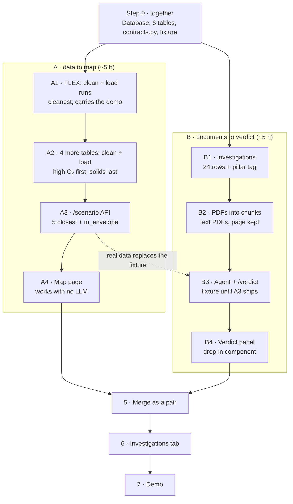

# Flame in Freefall — team plan

**Goal:** you set a cabin scenario (O₂, pressure, flame type) and the dashboard shows the NASA runs that sit near it, what happened in each one, and a cited verdict that says "untested" when nothing was tested there.

**Demo point:** at Moon-like conditions (O₂ ≥ 0.29, 0.70 atm), FLEX has 17 runs and none of them ended in extinction. In Earth air, 77% of FLEX runs extinguished. No solid material was ever tested at Moon-like conditions.
⚠️ Before the demo, check what "Disruption" means in the FLEX documents. If it doesn't mean "still burning", say "no extinctions", not "kept burning".

Background docs: `data-audit.md` (data and schema; its `tests` table is our `runs`) and `system-design.md` (architecture).

---

## Vocabulary — one word per thing

| Word | What it is | Example | Count |
|---|---|---|---|
| **Investigation** | One NASA study | FLEX (PSI-69) | 24 |
| **Run** | One burn inside a study | FLEX droplet 192F001 | ~2,400 |
| **Measurement** | One number recorded during a run | Burn time, extinction diameter | ~6k |
| **Chunk** | ~500 words of a PDF page, with its embedding | BASS-II report, p. 12 | ~25k |

| Name in code | What it does |
|---|---|
| `/scenario` | Search endpoint, plain SQL, no LLM: scenario in, nearby runs + `in_envelope` out |
| `/verdict` | The agent: it writes the cited answer |
| `find_runs` | Agent tool that calls `/scenario` |
| `search_papers` | Agent tool that runs vector search over `chunks` |
| `contracts.py` | Pydantic models shared by A and B |

*Why we fixed these names:* "tests" clashed with pytest, and pytest collects any class whose name starts with `Test`. Names are part of the contract, so they're settled now and don't change.

**FLEX** stands for Flame Extinguishment Experiment. On the ISS, a single fuel droplet (methanol or heptane) burned while the chamber's O₂, pressure and CO₂/He dilution were varied. The question was which atmospheres put a fire out. Every run ends as extinction, disruption or completion.

---

## The plan at a glance

The two lanes run at the same time. The dashed arrow is the only hand-off during the day: once A3 is done, B's agent stops reading the fixture and calls the real `/scenario`.

---

## Three rules for working in parallel

1. **Each table has one owner.** A owns `runs` and `measurements`. B owns `investigations`, `publications`, `documents` and `chunks`.
   *Why:* there are no write conflicts.
2. **The contracts are fixed in step 0:** the schema, the units, the names, and `contracts.py`.
   *Why:* each side can build against them before the other side is finished.
3. **Use a mock until the real thing exists:** B's agent reads `fixtures/scenario_moon.json` until A3 is done.
   *Why:* nobody waits.

---

## Step 0 — together (~45 min)

- **Start Postgres + pgvector and create the 6 tables.** *Why:* this is the shared interface.
- **Insert the 24 investigation IDs (`psi_id` + acronym) right away.** *Why:* every row in `runs` points to an investigation, so without the IDs A can't load anything until B finishes B1.
- **Agree the unit contract:**
  - `o2_frac` from 0 to 1
  - `pressure_atm` in atm
  - `flow_cm_s` in cm/s
  - `outcome` from a fixed list
  - `o2_is_ambient = false` for inverse flames
  - `raw jsonb` keeps the original row

  *Why:* every file ends up on the same axes.
- **Write `contracts.py`:** `ScenarioQuery`, `Run`, `ScenarioResponse` and `VerdictResponse`. Then save one valid example as `fixtures/scenario_moon.json`.

  *Why Pydantic:*
  - `o2_frac` must be ≤ 1, so a percentage value like 22.2 fails loudly instead of putting a dot in the wrong place on the map.
  - `outcome` is a `Literal`, so a typo like "ext" is rejected.
  - One model does three jobs: FastAPI's `response_model`, reading the fixture, and generating the agent tool's schema.

---

## A — Data to map (~5 h)

**Cleaning happens inside A1 and A2.** Each table gets one loader script: `load_flex.py`, `load_cfi.py` and so on.

Every loader follows the same steps:
1. Read the raw file.
2. Rename the columns.
3. Convert the units.
4. Replace placeholder values (RAMP, none, #VALUE!) with NULL.
5. Map the outcome to the fixed list.
6. Keep the original row in `raw`.
7. Insert into `runs`.

*Why there's no separate cleaning step:* each file is messy in its own way, so the person who understands the file also cleans it. The full list of fixes is in `data-audit.md`.

**A1. FLEX: clean and load (1 h)**
- Convert pressure from mmHg to atm, map "Test end" to `outcome`, and drop the run with pressure 0 and the duplicate 193F001.
- *Why first:* it's the cleanest file, every run has an outcome, and it carries the demo on its own.
- *Done when:* the Moon query returns 15 disruption and 2 completion.

**A2. CFI-G normal, then CFI (xlsx), then BASS-II, then BASS (xlsx): clean and load (2 h)**
- *Why this order:* value per hour. The high-O₂ data comes first; the solids are the messiest, so they come last.
- For the solids, set `outcome = unknown` for now.

**A3. `/scenario` (45 min)**
- It returns the 5 closest runs in (O₂, pressure). It sets `in_envelope = true` when at least 3 runs fall within a radius of the scenario.
- *Why a radius:* it's 10 lines of SQL, it's easy to explain, and "fewer than 3 runs nearby" is exactly what "untested" means.

**A4. Map page and app shell (1.5 h)**
- O₂ × pressure, with dots coloured by outcome, the tested zone shaded, a star for the scenario, and a filter by flame type.
- *Why before the agent:* it works without an LLM, so the demo is safe.

## B — Documents to verdict (~5 h)

**B1. Investigations, publications and pillar tags (45 min)**
- *Why:* this is the content for ranking, and the filter for `search_papers`.

**B2. PDFs into chunks (2 h)**
- Use only the PDFs that have text. Split them into chunks of about 500 words, keeping `psi_id` and the page number, then embed with bge-small.
- *Why skip the 83 image-only PDFs:* they're mostly engineering drawings, so OCR would take hours for very little text.
- *Why keep the page:* a citation has to be checkable.

**B3. Agent and `/verdict` (2 h)**
- Tools:
  - `find_runs` calls `/scenario`, and reads the fixture until A3 is done.
  - `search_papers` is vector search over the chunks of the investigations `find_runs` returned.
- Prompt rules:
  - Numbers come only from `find_runs`.
  - Every claim cites a chunk.
  - If `in_envelope = false`, the answer starts with "Untested".
- *Why these rules:* in fire safety, an invented number is the one fatal bug.

**B4. Verdict panel as a standalone component (30 min)**
- *Why:* the merge then comes down to placing the component on A's page.

---

## Together again

**5. Merge as a pair (1 h):** put the verdict under the map, with one scenario state that both read.
*Why pair:* it's the only place the two tracks touch.

**6. Investigations tab (1 h, whoever is free first):** rank investigations by the number of runs near the star, then by pillar.
*Why:* the challenge asks the dashboard to summarize and rank.

**7. Demo (1 h, protect this time):** show Earth air, then Moon conditions, then solid fabric as "Untested", then the verdict.
*Why:* the judges see the demo, not the code.

## Stretch goal

Use the LLM to extract the solid outcomes from the BASS / BASS-II free-text notes. B writes them to `fixtures/solid_outcomes.csv` (run_id, outcome, source_text) and A loads that file into `runs`.
*Why this split:* A still owns `runs`.

## Cut order

If time runs short, cut these first, in this order:
1. The stretch goal
2. The investigations tab
3. The agent (show the closest runs and paper links instead)

**Never cut A1, A3 or A4.**

## Checkpoints

1. Step 0, A1 and B1 are done: the data is in the database.
2. A3 and B2 are done: the API and the search work.
3. A4 and B3 are done: the map and the verdict each work on their own.
4. The merge is done: freeze features and move to the demo.
